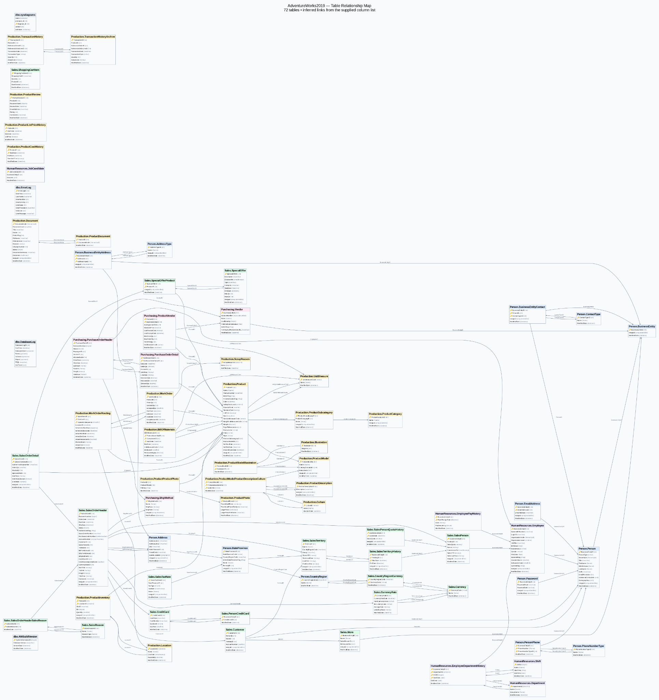
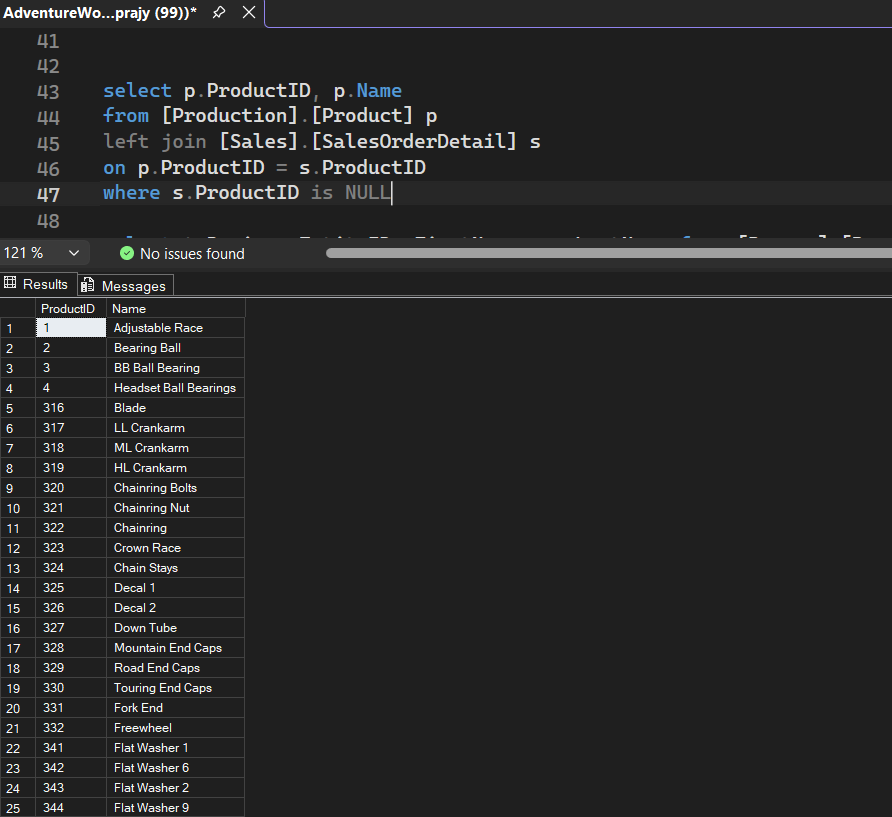

# AdventureWorks Sales Analysis with SQL Server

**SQL Portfolio Project | T-SQL · SQL Server · SSMS**

## Project Overview

This project explores Microsoft's AdventureWorks sample database using SQL Server. It demonstrates how relational data can answer practical business questions about sales-line revenue, sales volume, product and category performance, customer order value, and products without recorded sales.

The project includes commented SQL queries, individual analysis scripts, CSV result exports, an entity-relationship diagram (ERD), and SSMS screenshots.

> **Evidence note:** Numerical findings are not reported until the corresponding query outputs have been verified. See the `results/` folder for exported query results.

## Business Questions

1. What are the total sales-line revenue and total quantity ordered?
2. Which product categories generate the most sales-line revenue?
3. How do categories classify against defined revenue thresholds?
4. Which products rank highest by sales-line revenue?
5. What quantity has been ordered for each product, including products without matching sales records?
6. Which customers have the highest order value?
7. Which products have no matching sales-order detail records?
8. Second highest selling product. 

## KPI Definitions

| KPI | Definition | Source |
|---|---|---|
| Sales-line revenue | Sum of `SalesOrderDetail.LineTotal` | `Sales.SalesOrderDetail` |
| Quantity ordered | Sum of `SalesOrderDetail.OrderQty` | `Sales.SalesOrderDetail` |
| Category revenue | Sales-line revenue grouped by product category | Product → subcategory → category |
| Product revenue rank | Rank by sales-line revenue, descending | `RANK()` |
| Customer order value | Sum of `SalesOrderHeader.TotalDue` by customer | `Sales.SalesOrderHeader` |
| Products without recorded sales | Products with no matching sales-order detail rows | `LEFT JOIN` and `IS NULL` |

### Metric Caveats

- `LineTotal` is used for product and category sales-line revenue.
- `SalesOrderHeader.TotalDue` includes tax and freight, so it is not directly comparable to `LineTotal`.
- `OrderQty` represents the quantity recorded on sales-order lines, not necessarily the quantity shipped.
- A product without matching sales-order detail records is not necessarily unsuccessful or discontinued.
- Category revenue thresholds are project-defined rules, not official AdventureWorks classifications.

## Category Revenue Classification

The project uses these thresholds to classify category revenue:

| Classification | Revenue Threshold |
|---|---|
| High Revenue | Greater than $1,000,000 |
| Medium Revenue | $500,000 through $1,000,000, inclusive |
| Low Revenue | Below $500,000 |

The category analysis is designed to retain categories without matching sales lines and treat their revenue as zero.

## Repository Structure

```text
AdventureWorks2019-SQL-Sales-Analysis/
├── README.md
├── .gitignore
├── schema/
│   └── AdventureWorks2019_ERD.png
├── sql/
│   ├── 00_Overall_queries.sql
│   ├── 01_overall_sales_kpis.sql
│   ├── 02_product_quantity_sold.sql
│   ├── 03_category_revenue_classification.sql
│   ├── 04_top_products_by_revenue.sql
│   ├── 05_customer_sales_contribution.sql
│   └── 06_products_without_recorded_sales.sql
├── results/
│   ├── README.md
│   ├── 00_Overall_queries*.csv
│   ├── 01_overall_sales_kpis.csv
│   ├── 02_product_quantity_sold.csv
│   ├── 03_category_revenue_classification.csv
│   ├── 04_top_products_by_revenue.csv
│   ├── 05_customer_sales_contribution.csv
│   └── 06_products_without_recorded_sales.csv
└── screenshots/
    └── README.md
```

The tree above is a structural overview. The `00_Overall_queries*.csv` notation represents the practice-query exports, not a literal filename. The screenshots folder contains the individual PNG files documented in its README.

## Schema Reference

The file [`schema/AdventureWorks2019_ERD.png`](schema/AdventureWorks2019_ERD.png) provides a visual reference for the database's entity relationships. It can help trace joins between product, category, sales, customer, and employee tables.





The consolidated practice script, [`sql/00_Overall_queries.sql`](sql/00_Overall_queries.sql), contains the broader set of SQL exercises. The six individual scripts provide a more focused view of the main sales analysis.


## Visual Results Gallery

Explore selected query outputs from the AdventureWorks2019 SQL analysis.

### Sales and Product Analysis

| Top-Selling Products | Product Quantity Sold |
|---|---|
|  |  |

### Revenue Analysis

| Category Revenue Classification | Second-Highest-Selling Product |
|---|---|
|  |  |

### Data Quality and Customer Analysis

| Products Without Recorded Sales | Customer Sales |
|---|---|
|  |  |

*The screenshots show query outputs from the project. Refer to the SQL scripts and CSV exports for query logic and detailed results.*

## Analysis Scripts and Results

Each main analysis has a dedicated SQL script and a corresponding CSV export.

| Analysis | SQL Script | CSV Result | Screenshot |
|---|---|---|---|
| Overall sales KPIs | [View SQL](sql/01_overall_sales_kpis.sql) | [View CSV](results/01_overall_sales_kpis.csv) | [View Screenshot](screenshots/TotalSales%20per%20CustomerId.png) |
| Product quantity sold | [View SQL](sql/02_product_quantity_sold.sql) | [View CSV](results/02_product_quantity_sold.csv) | [View Screenshot](screenshots/list%20of%20all%20products%20and%20the%20total%20quantity%20sold.png) |
| Category revenue classification | [View SQL](sql/03_category_revenue_classification.sql) | [View CSV](results/03_category_revenue_classification.csv) | [View Screenshot](screenshots/Classification%20of%20categories.png) |
| Top products by revenue | [View SQL](sql/04_top_products_by_revenue.sql) | [View CSV](results/04_top_products_by_revenue.csv) | [View Screenshot](screenshots/list%20of%2010%20top%20selling%20Products.png) |
| Customer sales contribution | [View SQL](sql/05_customer_sales_contribution.sql) | [View CSV](results/05_customer_sales_contribution.csv) | [View Screenshot](screenshots/TotalSales%20per%20CustomerId.png) |
| Products without recorded sales | [View SQL](sql/06_products_without_recorded_sales.sql) | [View CSV](results/06_products_without_recorded_sales.csv) | [View Screenshot](screenshots/ProductsNeverSold.png) |
| Second-highest-selling product | [View Query](sql/07_secondhighest_selling_product.sql) | [View CSV](results/07_secondhighest_selling_product.csv) | [View Screenshot](screenshots/second%20highest%20selling%20product.png) |

The additional practice-query exports are documented in [`results/README.md`](results/README.md). Query-result screenshots are documented in [`screenshots/README.md`](screenshots/README.md).

## How to Run

1. Install or open SQL Server Management Studio (SSMS).
2. Restore or attach the AdventureWorks2019 sample database.
3. Open the desired `.sql` file from the `sql/` folder.
4. Select `AdventureWorks2019` as the active database, or adjust the database name to match your local setup.
5. Execute the query and inspect the result grid.
6. Export relevant result sets to `results/` and save supporting screenshots in `screenshots/`.
7. Verify that the exports correspond to the intended queries before documenting findings.

## Findings

Numerical findings will be added after validating the CSV exports or rerunning the queries.

Planned findings include:

- Total sales-line revenue and total quantity ordered.
- Highest-revenue product category.
- Highest-revenue product.
- Number of products without matching sales-order detail records.
- Number of categories in each revenue classification.

Each finding should identify the relevant query and use values verified against its output.

## Skills Demonstrated

- SQL Server and T-SQL
- `INNER JOIN` and `LEFT JOIN`
- Aggregation with `SUM()` and `COUNT()`
- `GROUP BY`, `ORDER BY`, and `CASE WHEN`
- Common Table Expressions (CTEs)
- Window functions such as `RANK()`
- Handling missing matches with `IS NULL` and `ISNULL()`
- KPI definition and business-question translation
- Exporting query results and documenting analysis

## Future Improvements

- Add year, quarter, and month sales-trend analysis.
- Add customer and product drill-down analysis.

## Dataset

**AdventureWorks2019** — Microsoft's sample database used for learning and demonstrating relational database concepts.

This is an educational portfolio project, not a representation of a live company's current performance.

## Author

**Prajyot Meshram**

Focus: SQL Analytics · Data Analysis · Business Intelligence